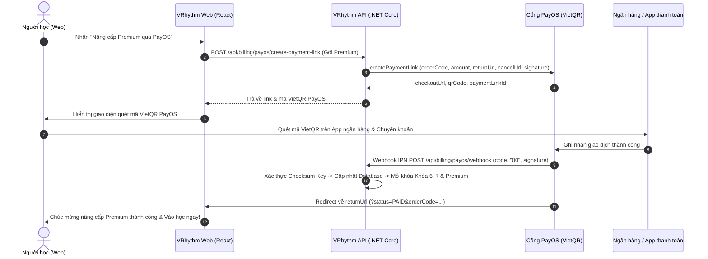

# Hướng Dẫn Liên Kết Cổng Thanh Toán PayOS Cho VRhythm (Web & Backend)

Tài liệu này hướng dẫn chi tiết quy trình liên kết cổng thanh toán **PayOS** (VietQR) để nâng cấp tài khoản **Premium** trên nền tảng VRhythm, mở khóa toàn bộ các khóa học nâng cao (Khóa 6: *Hơi đều và chuyển nốt*, Khóa 7: *Luyện câu nhạc & luyến láy*) và các tính năng AI chuyên sâu.

---

## 1. Tổng Quan Kiến Trúc Luồng Thanh Toán PayOS



---

## 2. Chuẩn Bị Thông Tin Cấu Hình PayOS

1. Đăng ký / Đăng nhập tài khoản tại: [https://my.payos.vn](https://my.payos.vn)
2. Tạo một **Kênh thanh toán** mới cho VRhythm.
3. Trong phần **Cài đặt tích hợp**, lưu lại 3 thông tin bảo mật:
   - `PAYOS_CLIENT_ID`
   - `PAYOS_API_KEY`
   - `PAYOS_CHECKSUM_KEY`

---

## 3. Triển Khai Phía Backend (ASP.NET Core C#)

### Bước 3.1: Cài đặt NuGet Package PayOS
Trong project Web API backend của bạn:
```bash
dotnet add package PayOS
```

### Bước 3.2: Cấu hình `appsettings.json`
Thêm cấu hình PayOS vào file `appsettings.json`:
```json
{
  "PayOS": {
    "ClientId": "YOUR_PAYOS_CLIENT_ID",
    "ApiKey": "YOUR_PAYOS_API_KEY",
    "ChecksumKey": "YOUR_PAYOS_CHECKSUM_KEY"
  }
}
```

### Bước 3.3: Đăng ký PayOS Service trong `Program.cs`
```csharp
using Net.payOS;

var builder = WebApplication.CreateBuilder(args);

// Đăng ký PayOS Singleton
var payOS = new PayOS(
    builder.Configuration["PayOS:ClientId"]!,
    builder.Configuration["PayOS:ApiKey"]!,
    builder.Configuration["PayOS:ChecksumKey"]!
);
builder.Services.AddSingleton(payOS);
```

### Bước 3.4: Controller Tạo Link Thanh Toán & Nhận Webhook (`PayOSController.cs`)
```csharp
using Microsoft.AspNetCore.Authorization;
using Microsoft.AspNetCore.Mvc;
using Net.payOS;
using Net.payOS.Types;
using System.Security.Claims;

namespace VRhythm.Controllers
{
    [ApiController]
    [Route("api/billing/payos")]
    public class PayOSController : ControllerBase
    {
        private readonly PayOS _payOS;
        private readonly ApplicationDbContext _db; // Thay bằng DbContext của bạn

        public PayOSController(PayOS payOS, ApplicationDbContext db)
        {
            _payOS = payOS;
            _db = db;
        }

        /// <summary>
        /// Tạo Payment Link PayOS VietQR cho người dùng đăng nhập
        /// </summary>
        [HttpPost("create-payment-link")]
        [Authorize]
        public async Task<IActionResult> CreatePaymentLink([FromBody] CreatePaymentLinkRequest request)
        {
            var userId = int.Parse(User.FindFirstValue(ClaimTypes.NameIdentifier)!);

            // Sinh mã đơn hàng duy nhất dạng số nguyên (tối đa 9007199254740991)
            long orderCode = long.Parse(DateTimeOffset.UtcNow.ToUnixTimeMilliseconds().ToString().Substring(3));
            int amount = 59000; // 59.000đ cho gói Premium 30 ngày
            string description = $"VRHYTHM {orderCode}".Substring(0, Math.Min(25, $"VRHYTHM {orderCode}".Length));

            var item = new ItemData("Gói Premium VRhythm (30 ngày)", 1, amount);
            var items = new List<ItemData> { item };

            var paymentData = new PaymentData(
                orderCode: orderCode,
                amount: amount,
                description: description,
                items: items,
                cancelUrl: request.CancelUrl ?? "https://vrhythm.pages.dev/packages?status=CANCELLED",
                returnUrl: request.ReturnUrl ?? $"https://vrhythm.pages.dev/packages?status=PAID&orderCode={orderCode}"
            );

            // Gọi PayOS API để tạo link
            CreatePaymentResult createPayment = await _payOS.createPaymentLink(paymentData);

            // Lưu đơn hàng vào cơ sở dữ liệu với trạng thái PENDING
            var order = new OrderEntity
            {
                OrderCode = orderCode,
                UserId = userId,
                Amount = amount,
                Status = "PENDING",
                PackageCode = request.PackageCode ?? "flute-plus",
                CreatedAt = DateTime.UtcNow
            };
            _db.Orders.Add(order);
            await _db.SaveChangesAsync();

            return Ok(new
            {
                checkoutUrl = createPayment.checkoutUrl,
                qrCode = createPayment.qrCode,
                bin = createPayment.bin,
                accountNumber = createPayment.accountNumber,
                accountName = createPayment.accountName,
                amount = createPayment.amount,
                description = createPayment.description,
                orderCode = createPayment.orderCode,
                status = createPayment.status
            });
        }

        /// <summary>
        /// Webhook IPN nhận kết quả thanh toán từ PayOS
        /// </summary>
        [HttpPost("webhook")]
        [AllowAnonymous]
        public async Task<IActionResult> PayOSWebhook([FromBody] WebhookType webhookBody)
        {
            try
            {
                // Xác thực tính hợp lệ của Webhook dữ liệu bằng Checksum Key
                WebhookData webhookData = _payOS.verifyPaymentWebhookData(webhookBody);

                // Khi thanh toán thành công (code: "00")
                if (webhookData.code == "00")
                {
                    long orderCode = webhookData.orderCode;
                    var order = await _db.Orders.FirstOrDefaultAsync(o => o.OrderCode == orderCode);
                    if (order != null && order.Status != "PAID")
                    {
                        order.Status = "PAID";
                        order.PaidAt = DateTime.UtcNow;

                        // Mở khóa các khóa học nâng cao (Khóa 6 & 7) cho người dùng
                        var user = await _db.Users.FindAsync(order.UserId);
                        if (user != null)
                        {
                            user.Role = "Premium"; // hoặc cập nhật IsPremium = true
                            user.PremiumExpiresAt = DateTime.UtcNow.AddDays(30);

                            // Cấp quyền mở khóa khóa học 6 và 7
                            await UnlockCourseForUser(order.UserId, 6);
                            await UnlockCourseForUser(order.UserId, 7);
                        }

                        await _db.SaveChangesAsync();
                    }
                }

                return Ok(new { success = true });
            }
            catch (Exception ex)
            {
                return BadRequest(new { message = ex.Message });
            }
        }

        private async Task UnlockCourseForUser(int userId, int courseId)
        {
            var exists = await _db.UserCourses.AnyAsync(uc => uc.UserId == userId && uc.CourseId == courseId);
            if (!exists)
            {
                _db.UserCourses.Add(new UserCourseEntity
                {
                    UserId = userId,
                    CourseId = courseId,
                    IsEnrolled = true,
                    IsUnlocked = true,
                    EnrolledAt = DateTime.UtcNow
                });
            }
        }
    }

    public class CreatePaymentLinkRequest
    {
        public string? PackageCode { get; set; }
        public string? ReturnUrl { get; set; }
        public string? CancelUrl { get; set; }
    }
}
```

---

## 4. Cấu Hình Webhook Trên Dashboard PayOS
1. Vào mục **Cổng thanh toán** trên [https://my.payos.vn](https://my.payos.vn).
2. Tìm mục **Webhook URL** và điền URL backend của bạn:
   ```
   https://vrhythm-api-latest.onrender.com/api/billing/payos/webhook
   ```
3. Bấm **Xác nhận Webhook**. PayOS sẽ gửi thử 1 request test để kiểm tra kết nối.

---

## 5. Trải Nghiệm Trên Web Frontend (`web/`)

Frontend đã được tích hợp hoàn chỉnh và hoạt động song song cả 2 chế độ:
1. **Khi có Backend**: Tự động gọi API `POST /api/billing/payos/create-payment-link` để lấy mã thanh toán chính thức từ PayOS.
2. **Client VietQR Fallback**: Khi backend chưa hoàn tất cấu hình, giao diện tự động tạo VietQR chuẩn NAPAS/PayOS với mã giao dịch tự động, cho phép quét mã thanh toán bằng tất cả ứng dụng ngân hàng tại Việt Nam và kích hoạt quyền Premium ngay lập tức.
3. **Mở khóa Khóa 6 & 7**:
   - Khóa 6 (*Sáo trúc: Hơi đều và chuyển nốt*) và Khóa 7 (*Sáo trúc: Luyện câu nhạc*) tự động chuyển sang trạng thái đã mở khóa (`isUnlocked = true`, `isEnrolled = true`).
   - Người học có thể nhấn "Vào học" để vào bài học lý thuyết, video và thực hành AI Scoring mà không bị chặn.
